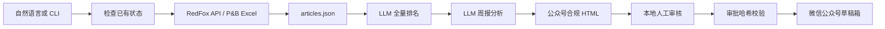

# EarlyData Weekly Publisher

面向 EarlyData 生物医药周报的完整交付工具：从 RedFox API 或 P&B Excel 获取新闻，使用 LLM 完成全量语义排名与各板块分析，生成微信公众号兼容 HTML，经人工审核后安全写入公众号草稿箱。

这个项目关注的不是单次排版，而是一条可恢复、可审核、可追溯的内容生产流水线。



## 核心能力

- **LLM 语义生成**：对候选新闻进行批量语义排名，再生成关键信号、背景、影响判断、公司/机构标签、药物/技术标签及业务启示。默认不会在 LLM 失败时静默退回规则生成。
- **双数据源接入**：支持 RedFox API 在线获取，也支持导入本地 P&B 格式 Excel，并按报告日期窗口过滤。
- **状态感知与断点续跑**：自动识别已有原始数据、生成稿、审核稿、批准状态和发布回执，优先复用有效产物，避免重复获取或重复调用 LLM。
- **人工审核工作台**：在浏览器中编辑内容、锁定字段、查看排名证据、处理质量问题、预览公众号 HTML，并确认最终发布稿。
- **发布安全门禁**：审核批准和发布授权是两个独立步骤；发布前校验审核稿与 HTML 哈希，发布后保存回执，默认阻止重复创建相同草稿。
- **Agent 引导式交付**：仓库自带项目级 Skill，可通过自然语言完成日期确认、来源选择、复用判断、审核和发布。

## 快速开始

### 1. 安装

要求 Python 3.10 或更高版本。

```powershell
git clone https://github.com/GuJiaWen777/SentimentTracker.git
cd SentimentTracker
python -m venv .venv
.\.venv\Scripts\Activate.ps1
python -m pip install -e ".[dev]"
Copy-Item .env.example .env
```

根据所选数据源、LLM 后端和发布方式填写 `.env`。不要提交真实密钥。

### 2. 使用 Agent 引导流程

在支持项目级 Skills 的 Agent 中打开仓库，仓库内的 [交付 Skill](.agents/skills/deliver-earlydata-weekly/SKILL.md) 会响应周报生成、继续审核和发布请求。例如：

```text
生成 2026.05.25 到 05.31 的 EarlyData 周报
继续上次的报告，已有数据就不要重新获取
打开本期周报审核页面
确认发布到微信公众号草稿箱
```

Agent 会先运行状态检查，再根据实际阶段只询问当前必需的决定。已有 `articles.json` 时会建议复用，已有生成稿时直接进入审核，已发布时返回现有回执而不是重复创建草稿。

## CLI 工作流

所有命令都从仓库根目录运行。安装后使用 `earlydata-weekly`。

### 1. 检查当前状态

```powershell
earlydata-weekly status --start 2026-05-25 --end 2026-05-31
```

也可以检查指定目录：

```powershell
earlydata-weekly status --report-dir "data/reports/20260525_20260531"
```

### 2. 获取或导入数据

RedFox API：

```powershell
earlydata-weekly fetch `
  --start 2026-05-25 --end 2026-05-31 `
  --account "医药魔方" `
  --output "data/reports/20260525_20260531/articles.json"
```

P&B Excel：

```powershell
earlydata-weekly ingest-xlsx `
  --start 2026-05-25 --end 2026-05-31 `
  --xlsx "data/input/weekly.xlsx" `
  --output "data/reports/20260525_20260531/articles.json"
```

### 3. LLM 排名与内容生成

```powershell
earlydata-weekly build `
  --start 2026-05-25 --end 2026-05-31 `
  --input "data/reports/20260525_20260531/articles.json" `
  --output-dir "data/reports/20260525_20260531"
```

默认使用 `.env` 中的 `LLM_BACKEND`。也可以显式指定：

```powershell
earlydata-weekly build `
  --start 2026-05-25 --end 2026-05-31 `
  --input "data/reports/20260525_20260531/articles.json" `
  --output-dir "data/reports/20260525_20260531" `
  --llm-backend codex
```

`--generator rules` 仅用于明确选择的离线兜底或测试，不会被自动启用。

### 4. 人工审核

```powershell
earlydata-weekly review --report-dir "data/reports/20260525_20260531"
```

默认打开 `http://127.0.0.1:8765/`。在工作台中保存会生成审核稿；点击“确认发布稿”后，系统记录当前审核稿和 HTML 的哈希。任何后续内容修改都会使批准失效，需要重新确认。

### 5. 发布到公众号草稿箱

```powershell
earlydata-weekly publish `
  --report-dir "data/reports/20260525_20260531" `
  --confirm
```

该命令只创建草稿，不会群发。默认封面为：

```text
https://www.earlydata.com/assets/early-data-logo.png
```

同一批准版本已有有效 `publication_receipt.json` 时，命令会返回原 `media_id`。只有明确需要再次创建草稿时才使用 `--force-new-draft`。

## 工作流状态

| 状态 | 含义 | 建议动作 |
| --- | --- | --- |
| `empty` | 没有可复用数据 | 选择 RedFox 或 Excel |
| `articles_ready` | 已有有效 `articles.json` | 复用数据并运行 LLM 生成 |
| `ready_for_review` | 生成稿和 HTML 已完成 | 打开审核工作台 |
| `review_in_progress` | 已保存人工修改但未批准 | 继续审核并确认发布稿 |
| `approved` | 审核稿与 HTML 哈希有效 | 单独确认是否发布草稿 |
| `published` | 当前批准版本已有发布回执 | 返回回执，避免重复发布 |

当同一日期窗口存在多个报告目录时，`status --start ... --end ...` 会选择进度最完整且有效的目录继续处理。

## 主要产物

每期报告默认保存在 `data/reports/YYYYMMDD_YYYYMMDD/`：

| 文件 | 用途 |
| --- | --- |
| `articles.json` | 标准化后的原始新闻和来源证据 |
| `ranking.json` | LLM 排名结果、分数与选择依据 |
| `brief.json` | LLM 生成的结构化初稿 |
| `wechat_article.md` | 便于阅读和归档的 Markdown |
| `wechat_article_img.html` | EarlyData 主题的公众号兼容 HTML |
| `brief.reviewed.json` | 人工保存后的结构化审核稿 |
| `reviewed/wechat_article_img.html` | 审核稿对应的最终 HTML |
| `review_state.json` | 字段锁定、批准状态和内容哈希 |
| `publication_receipt.json` | 微信草稿 `media_id` 与发布版本哈希 |

## 配置

### LLM 后端

| `LLM_BACKEND` | 运行方式 | 关键配置 |
| --- | --- | --- |
| `api` | OpenAI 兼容 Chat Completions API | `LLM_API_KEY`、`LLM_API_MODEL`、`LLM_API_BASE_URL` |
| `claude` | 本机 Claude CLI | CLI 已登录并位于 `PATH`，可选 `LLM_CLAUDE_MODEL` |
| `codex` | 本机 Codex CLI | CLI 已登录并位于 `PATH`，可选 `LLM_CODEX_MODEL` |

排名和综合分析可分别通过 `LLM_RANK_BATCH_SIZE`、`LLM_SYNTHESIS_CANDIDATES` 控制输入规模。完整配置见 [.env.example](.env.example)。

### 数据和发布

- `REDFOX_API_KEY`：使用 RedFox API 时必填。
- `WECHAT_APP_ID`、`WECHAT_APP_SECRET`：发布到微信公众号草稿箱时必填。
- `WECHAT_AUTHOR`：公众号文章作者，默认 `EARLY DATA`。

## 质量与安全

- 生成阶段保留来源文章和 LLM 排名证据，审核工作台可定位内容依据。
- HTML 输出在写入文件前执行公众号兼容性校验。
- 质量检查覆盖标题、摘要、信号结构、证据引用和关键字段完整性。
- 未批准的报告不能通过 `--report-dir` 发布。
- 审核后修改 JSON 或 HTML 会导致哈希不一致，发布会被拒绝。
- `--confirm` 是创建微信草稿的必需显式授权。
- 发布只进入草稿箱，不执行群发。

## 开发与文档

运行测试：

```powershell
pytest -q
```

进一步说明：

- [架构说明](docs/ARCHITECTURE.md)
- [内容生成规则](docs/CONTENT_RULES.md)
- [运行与发布手册](docs/OPERATIONS.md)
- [Agent 状态机](.agents/skills/deliver-earlydata-weekly/references/state-machine.md)

项目当前保持“小核心”边界：采集、LLM 语义生成、合规 HTML、人工审核和微信草稿交付。通用舆情平台、前端门户和群发运营不在此仓库范围内。
