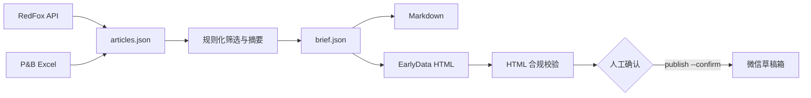

# 架构与数据契约

## 目标与边界

本项目交付一个可重复执行的周报闭环：采集生物医药公众号文章、生成可审阅的信号简报、渲染符合公众号约束的 EarlyData HTML，并在人工确认后写入微信公众号草稿箱。

项目不会自动群发，也不会在 `run` 或 `build` 阶段调用任何微信公众号写接口。草稿箱写入只能由 `publish --confirm` 触发。

## 流程



## 模块职责

`src/earlydata_weekly_publisher/cli.py` 是命令行入口，负责参数、日期窗口和发布门禁。

`src/earlydata_weekly_publisher/pipeline.py` 承担完整业务链路：

- `fetch_redfox`：按账号、日期从 RedFox 列表和详情接口采集。
- `ingest_pb_xlsx`：读取 P&B Excel 的标题、账号、日期、链接、互动指标和正文。
- `build_brief`：产业相关性排序、重复标题去重、摘要、信号分类、公司和技术标签。
- `render_html`：按 EarlyData Signal 视觉契约渲染 `wechat_article_img.html`。
- `validate_html`：拒绝外链样式、脚本、`div`、定位布局和未包裹的中文文本。
- `publish_draft`：上传封面与正文图片，并调用草稿箱接口。

HTML 视觉契约基于 `theme-earlydata-signal.html`：白色主背景、浅灰边框、4 个数据卡、关键信号、标签块、新闻条目与底部来源。渲染代码内置这一契约，因此运行项目不依赖本机 Codex skill 目录。

## 数据契约

`articles.json` 是采集层与生成层之间的稳定接口：

```json
{
  "articles": [{
    "title": "文章标题",
    "source": "公众号名称",
    "published_at": "2026-05-30",
    "content": "正文",
    "summary": "可选摘要",
    "url": "文章链接",
    "tags": ["可选分类"],
    "entities": ["可选机构"],
    "read_count": 0,
    "like_count": 0,
    "share_count": 0,
    "recommend_count": 0
  }]
}
```

`brief.json` 是编辑审阅接口，包含日期窗口、来源文章总数、仪表盘、重点公司/机构、重点药物/技术类型、6 条以内重点信号、行动建议和来源。人工微调应优先在这里完成，再重新调用渲染函数或 `build`。

## 可演进点

- 新数据源：归一化为 `Article` 后复用 `build_brief`。
- 内容规则：在 `BIOPHARMA_TERMS`、`STRATEGIC_EVENT_TERMS`、`PHARMA_TYPES` 和测试样例中同步调整。
- 视觉主题：只修改 `render_html` 及相关 HTML 测试，保留 `validate_html` 的微信兼容约束。
- LLM 辅助：可在 `brief.json` 之后增加受控编辑步骤，但必须保留来源链接和人工发布确认。
