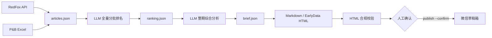

# 架构与数据契约

## 目标与边界

本项目交付一个可重复执行的周报闭环：采集生物医药公众号文章、生成可审阅的信号简报、渲染符合公众号约束的 EarlyData HTML，并在人工确认后写入微信公众号草稿箱。

项目不会自动群发，也不会在 `run` 或 `build` 阶段调用任何微信公众号写接口。草稿箱写入只能由 `publish --confirm` 触发。

## 流程



## 模块职责

`src/earlydata_weekly_publisher/cli.py` 是命令行入口，负责参数、日期窗口和发布门禁。

核心模块：

- `pipeline.py`：数据采集、Excel 归一化、规则备用模式、Markdown/HTML 渲染和合规校验。
- `wechat.py`：微信草稿创建与更新、access token 缓存刷新、图片去重上传和网络重试。
- `llm_client.py`：OpenAI-compatible API、Claude CLI、Codex CLI 三种结构化 LLM 传输，并累计 token/费用用量。
- `semantic_generation.py`：全部新闻分批语义排名、候选去重、最终 6 条选择、最多 6 条备选和所有板块的语义生成。
- `ranking_cache.py`：按文章内容、模型和提示词版本索引的排名缓存，支持增量生成。
- `signal_history.py`：SQLite 信号历史库，记录已批准报告的信号、分类和重点标签，并计算连续出现与跨周趋势。
- `artifacts.py`：持久化 JSON 的 `schema_version` 写入与兼容性校验；旧文件按 v0 读取，新版本文件明确拒绝。
- `run_manifest.py`：把本次运行的后端、模型、提示词版本、用量、缓存、耗时和产物哈希写入 `run.json`。
- `doctor.py`：检查 Python、`.env`、LLM 后端、数据目录、缓存/历史库和审核端口，不输出密钥。
- `prompts.py`：CEO 受众的排名标尺、事实约束、历史趋势上下文和整期分析提示词。
- `cli.py`：参数、日期窗口、LLM 后端选择、缓存与历史配置、运行清单和发布门禁。

HTML 视觉契约基于 `theme-earlydata-signal.html`：白色主背景、浅灰边框、4 个数据卡、关键信号、标签块、新闻条目与底部来源。渲染代码内置这一契约，因此运行项目不依赖本机 Codex skill 目录。

## 数据契约

`articles.json` 是采集层与生成层之间的稳定接口。`article_id` 在首次生成时写入并持久化；后续重排或删除其他行不会改变已有文章的 ID，审核证据因此保持稳定。缺少 `article_id` 的旧文件在读取后按当前位置补齐。

```json
{
  "schema_version": 1,
  "articles": [{
    "article_id": "a0001",
    "title": "文章标题",
    "source": "公众号名称",
    "published_at": "2026-05-30",
    "content": "正文",
    "summary": "可选摘要",
    "url": "文章链接",
    "tags": ["可选分类"],
    "entities": ["可选机构"],
    "read_count": 0,
    "like_count": 0,
    "share_count": 0,
    "recommend_count": 0
  }]
}
```

`ranking.json` 保存窗口内每篇新闻的 LLM 分数、类别、排名理由和来源信息。重复标题也会被评分，只在进入最终综合候选池时去重。

`brief.json` 是编辑审阅接口，包含模型与候选数量、日期窗口、仪表盘、重点公司/机构、重点药物/技术类型、6 条重点信号、最多 6 条备选（`alternates`）、行动建议和来源。`items` 与 `alternates` 都带有 `article_id`、`score`、`category` 和 `reason`，审核台可以在两者之间换稿而不重新调用 LLM。

所有报告与状态 JSON（`articles.json`、`brief.json`、`ranking.json`、`review_state.json`、`publication_receipt.json`、`run.json`）以及 `status`/`history report` 输出都带 `schema_version`；本地缓存另有独立的 `version` 字段，可随时重建。缺少版本号视为 v0 旧格式；高于当前支持的版本会被拒绝，并提示升级工具，而不是猜测字段含义。

`run.json` 是一次运行的审计记录：`status`、命令、时间窗口、耗时、git 提交、Python/平台、LLM 后端与模型、排名/综合提示词版本、token 用量、缓存命中、历史期数、产物相对路径与 SHA-256。生成失败时也会写出 `status=failed` 和错误类型/信息，便于事后排查。

## 增量生成与跨周历史

- `data/cache/ranking.json` 按 `模型 + RANKING_PROMPT_VERSION + 文章内容/元数据` 生成缓存键。命中项直接复用分数、分类和理由；未命中项才进入分批排名。缓存写入失败只告警，不中断生成。
- `data/history/signals.sqlite3` 以日期窗口为 `report_key`。审核批准时写入 `reports`、`signals` 和 `entities` 三张表；同一窗口重复批准是幂等覆盖。
- `build`/`run` 默认读取窗口之前的历史，把连续出现实体和近期信号数量作为综合分析的只读上下文；`--no-history` 可以完全隔离。
- `history report` 计算每个实体的连续出现期数（按已记录报告的窗口顺序）和本期相对上期的新增标签。

```text
ranking cache  ──命中──> 复用排名 ─┐
      └──未命中──> LLM 排名 ───────┴──> 综合分析（含候选池）──> brief.json
signal history ──只读上下文──> 综合分析
       ▲
       └──审核批准时写入
```

## 发布可靠性

- access token 按 `app_id + secret 指纹` 缓存在进程内，提前 5 分钟过期；401/42001/40014 时强制刷新并重放一次。
- 网络异常、HTTP 429/5xx 和微信 `-1`/`45009` 采用指数退避重试；错误信息只包含微信返回的 `errmsg` 和错误码。
- 封面永久素材和文章图片按“账号 + 内容 SHA-256”缓存；文章图片缓存 7 天，避免频繁重传。
- `publication_receipt.json` 记录 `media_id`、首次发布时间、更新时间与更新次数；`publish --update-draft` 调用 `draft/update` 更新原草稿。

## 可演进点

- 新数据源：归一化为 `Article` 后复用 `generate_brief`。
- 排名与写作口径：修改 `prompts.py`，并同步增加结构化输出测试。
- 视觉主题：只修改 `render_html` 及相关 HTML 测试，保留 `validate_html` 的微信兼容约束。
- 新模型后端：实现 `complete_json` 协议并接入 `create_llm_client`，不得绕过 JSON 校验和人工发布确认。
