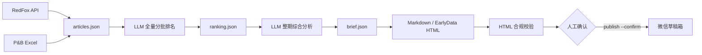

# 架构与数据契约

## 目标与边界

本项目交付一个可重复执行的周报闭环：采集生物医药公众号文章、生成可审阅的信号简报、渲染符合公众号约束的 EarlyData HTML，并在人工确认后写入微信公众号草稿箱。

项目不会自动群发，也不会在 `run` 或 `build` 阶段调用任何微信公众号写接口。草稿箱写入只能由 `publish --confirm` 触发。

## 流程



## 模块职责

`src/earlydata_weekly_publisher/cli.py` 是命令行入口，负责参数、日期窗口和发布门禁。

核心模块：

- `pipeline.py`：数据采集、Excel 归一化、规则备用模式、HTML 渲染、合规校验和微信公众号上传。
- `llm_client.py`：OpenAI-compatible API、Claude CLI、Codex CLI 三种结构化 LLM 传输。
- `semantic_generation.py`：全部新闻分批语义排名、候选去重、最终 6 条选择和所有板块的语义生成。
- `prompts.py`：CEO 受众的排名标尺、事实约束和整期分析提示词。
- `cli.py`：参数、日期窗口、LLM 后端选择和发布门禁。

HTML 视觉契约基于 `theme-earlydata-signal.html`：白色主背景、浅灰边框、4 个数据卡、关键信号、标签块、新闻条目与底部来源。渲染代码内置这一契约，因此运行项目不依赖本机 Codex skill 目录。

## 数据契约

`articles.json` 是采集层与生成层之间的稳定接口：

```json
{
  "articles": [{
    "title": "文章标题",
    "source": "公众号名称",
    "published_at": "2026-05-30",
    "content": "正文",
    "summary": "可选摘要",
    "url": "文章链接",
    "tags": ["可选分类"],
    "entities": ["可选机构"],
    "read_count": 0,
    "like_count": 0,
    "share_count": 0,
    "recommend_count": 0
  }]
}
```

`ranking.json` 保存窗口内每篇新闻的 LLM 分数、类别、排名理由和来源信息。重复标题也会被评分，只在进入最终综合候选池时去重。

`brief.json` 是编辑审阅接口，包含模型与候选数量、日期窗口、仪表盘、重点公司/机构、重点药物/技术类型、6 条重点信号、行动建议和来源。

## 可演进点

- 新数据源：归一化为 `Article` 后复用 `generate_brief`。
- 排名与写作口径：修改 `prompts.py`，并同步增加结构化输出测试。
- 视觉主题：只修改 `render_html` 及相关 HTML 测试，保留 `validate_html` 的微信兼容约束。
- 新模型后端：实现 `complete_json` 协议并接入 `create_llm_client`，不得绕过 JSON 校验和人工发布确认。
